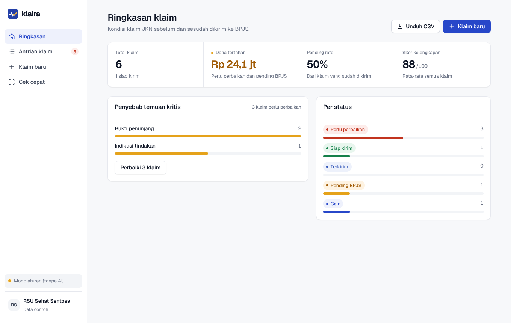

# Klaira

Klaira adalah software web yang mengecek resume medis sebelum klaim JKN dikirim ke BPJS. Untuk setiap klaim, Klaira:

- menyarankan kode ICD-10 (diagnosis) dan ICD-9-CM (prosedur), lengkap dengan alasan dari isi resume,
- menemukan kekurangan dokumentasi yang sering membuat klaim pending, misalnya diagnosis sekunder tanpa bukti lab, tindakan tanpa indikasi, atau DPJP dan tanggal yang hilang,
- memberi skor kelengkapan (0–100) dan risiko pending,
- melacak status klaim: perlu perbaikan → siap kirim → terkirim → pending BPJS → cair.

> **Status: versi pertama (MVP) untuk demo dan pilot.** Jangan pakai data pasien sungguhan sebelum syarat keamanan di bawah terpenuhi.

## Mencari partner

Klaira dibangun untuk satu masalah nyata: banyak klaim JKN rumah sakit tertahan (pending) karena resume medis kurang lengkap atau kodenya tidak tepat, dan dananya baru cair berbulan-bulan kemudian. Mulai Agustus 2026 rumah sakit juga harus beralih ke RME yang terhubung SATUSEHAT, dengan target "No RME, No Claim" pada 2027.

Versi ini masih prototipe. Untuk menjadikannya produk yang dipakai rumah sakit, saya mencari partner di Indonesia, terutama:

- **Koder klinis atau orang casemix** yang paham ICD-10, ICD-9-CM, INA-CBG, dan alasan pending dari verifikator BPJS.
- **Orang yang punya akses ke rumah sakit atau klinik** (manajemen RS tipe C/D, jaringan klinik, vendor SIMRS) untuk pilot.
- **Engineer** yang tertarik dengan integrasi SIMRS, SATUSEHAT (FHIR), dan keamanan data kesehatan.
- **Dokter atau praktisi kesehatan** yang mau memberi masukan klinis.

Tertarik? Buka [Issue](../../issues/new) dengan judul "Partner: [peran kamu]", ceritakan singkat latar belakangmu dan bagian mana yang ingin kamu kerjakan. Masukan, kritik, atau sekadar cerita pengalaman dengan klaim BPJS juga sangat membantu.



## Cara menjalankan

Butuh Python 3.10 atau lebih baru.

```bash
cd klaira-app
python3 -m pip install -r requirements.txt
uvicorn klaira.main:app --reload
```

Lalu buka http://localhost:8000.

**Di Windows:** pasang Python dari python.org (centang "Add Python to PATH" saat instalasi), lalu klik dua kali `Jalankan Klaira.bat`. Browser akan terbuka sendiri. Saat database masih kosong, Klaira mengisi 6 klaim contoh (fiktif).

### Mengaktifkan AI

Tanpa kunci API, Klaira memakai **mesin aturan sederhana**: daftar kata kunci kecil, cocok untuk demo. Untuk analisis AI (Claude):

```bash
export ANTHROPIC_API_KEY=sk-ant-...      # buat di https://console.anthropic.com
uvicorn klaira.main:app --reload
```

Pengaturan lain ada di `.env.example`:

| Variabel | Default | Fungsi |
|---|---|---|
| `KLAIRA_MODEL` | `claude-opus-5-5` | Model AI |
| `KLAIRA_EFFORT` | `medium` | `low`, `medium`, atau `high`. Makin tinggi makin teliti dan makin mahal |
| `KLAIRA_DB` | `data/klaira.db` | Lokasi database SQLite |
| `KLAIRA_SEED_DEMO` | `1` | Isi data contoh saat database kosong |

Kalau AI gagal (kunci salah, kuota habis, koneksi putus, atau AI menolak), Klaira otomatis memakai mesin aturan dan menuliskan alasannya di hasil analisis.

### Menjalankan tes

```bash
python3 -m pytest -q
```

Tes tidak memanggil API sungguhan, jadi gratis.

## Struktur

```
klaira/
  main.py      API dan server web (FastAPI)
  analyzer.py  Analisis AI dengan Claude, plus jalur cadangan ke aturan
  rules.py     Mesin aturan, dan penyamaran NIK / no. BPJS / no. HP
  schemas.py   Bentuk data (juga dipakai sebagai format jawaban AI)
  db.py        Penyimpanan SQLite: klaim dan riwayat perubahan
  demo.py      Data contoh fiktif
  static/      Tampilan web (HTML, CSS, JS tanpa framework)
tests/         Tes otomatis
```

### API

| Metode | Alamat | Fungsi |
|---|---|---|
| GET | `/api/health` | Status server, dan apakah AI aktif |
| GET | `/api/claims?status=` | Daftar klaim |
| POST | `/api/claims` | Tambah klaim, langsung dianalisis |
| GET | `/api/claims/{id}` | Detail klaim dan riwayatnya |
| PUT | `/api/claims/{id}` | Ubah klaim. Resume baru otomatis dianalisis ulang |
| POST | `/api/claims/{id}/analyze` | Analisis ulang |
| POST | `/api/claims/{id}/status` | Ubah status (terkirim, pending_bpjs, cair, ...) |
| POST | `/api/analyze` | Cek cepat tanpa menyimpan |
| GET | `/api/stats` | Angka untuk dashboard |
| GET | `/api/claims/export.csv` | Unduh semua klaim sebagai CSV |

Dokumentasi interaktif tersedia di http://localhost:8000/docs.

## Biaya AI

Satu analisis memakai sekitar 2.000–4.000 token input dan 1.000–3.000 token output. Dengan `claude-opus-5-5` ($4 per juta token input, $20 per juta token output), biayanya kira-kira **Rp 1.000–1.500 per klaim** (perkiraan, kurs Rp 16.500). Untuk RS dengan 1.500 klaim per bulan, biayanya sekitar Rp 1,5–2,3 juta per bulan, jauh di bawah harga langganan Rp 15 juta. Ukur angka sebenarnya di console Anthropic saat pilot.

## Sebelum dipakai dengan data pasien sungguhan

- [ ] Uji akurasi kode pada 200+ klaim lama yang sudah diverifikasi BPJS, didampingi koder berpengalaman.
- [ ] Tambah login dan peran pengguna (koder, kepala casemix, admin). **Versi ini belum punya login.**
- [ ] Hosting di server di Indonesia dengan HTTPS, backup, dan log akses (UU PDP No. 27/2022).
- [ ] Perjanjian pemrosesan data dengan RS, dan cek ketentuan pemrosesan data penyedia AI.
- [ ] Daftar sebagai Penyelenggara Sistem Elektronik (PSE).
- [ ] Ganti SQLite dengan PostgreSQL bila dipakai banyak pengguna sekaligus.

## Langkah pengembangan berikutnya

1. Integrasi SIMRS: ambil resume langsung dari SIMRS, jangan copy-paste.
2. Kirim RME ke SATUSEHAT (FHIR) dan cek kelengkapan sumber data yang diwajibkan.
3. Estimasi grup dan tarif INA-CBG.
4. Belajar dari hasil verifikasi BPJS: simpan alasan pending sebenarnya untuk mempertajam pengecekan.
5. AI scribe: dokter bicara, resume terisi otomatis.
